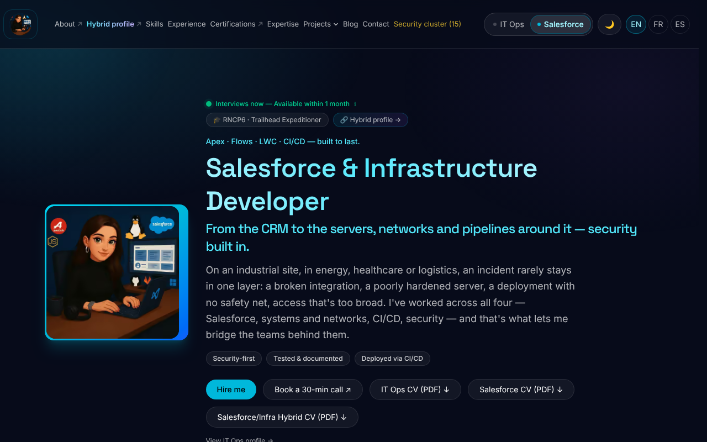
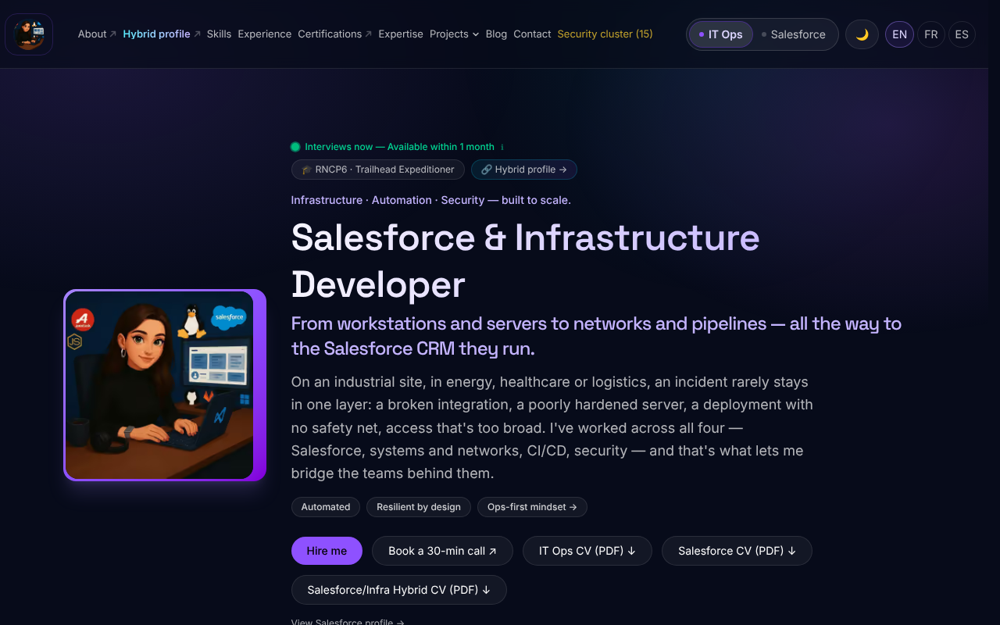
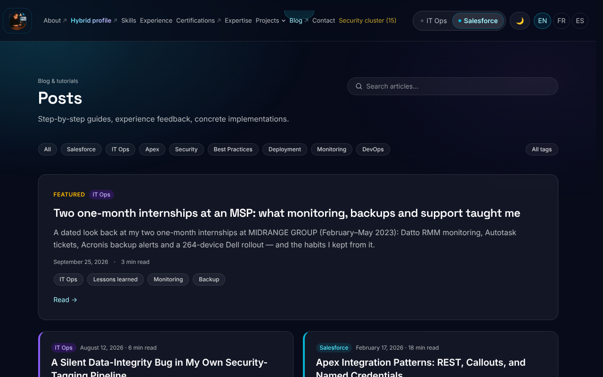
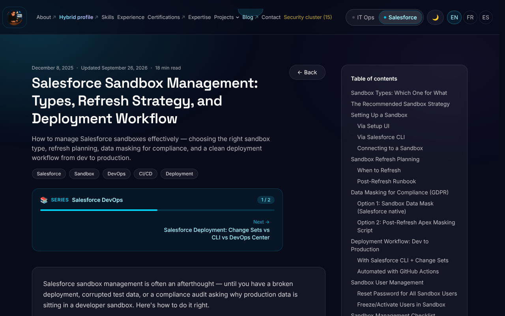
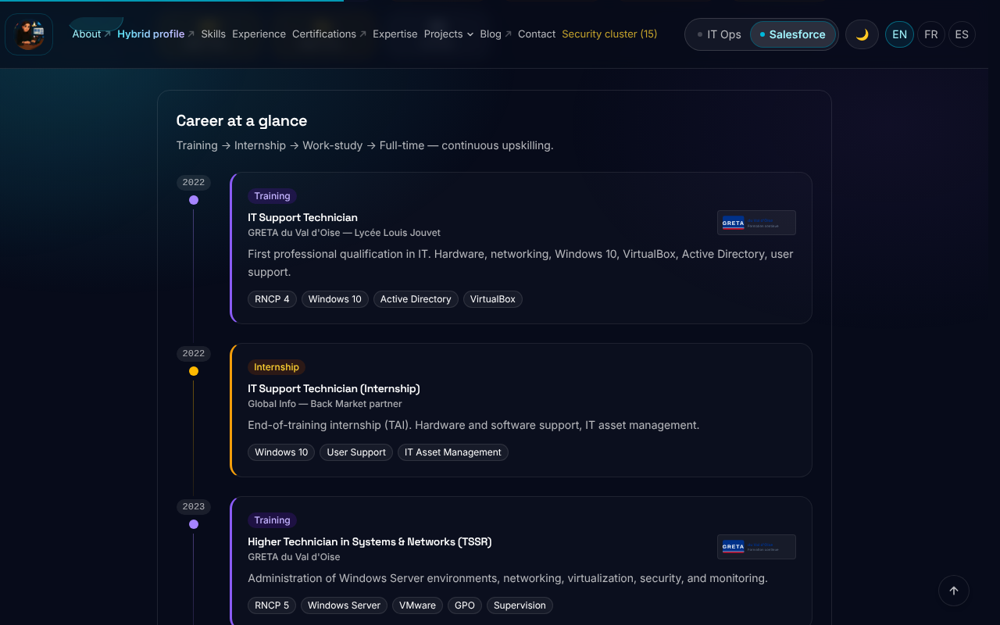
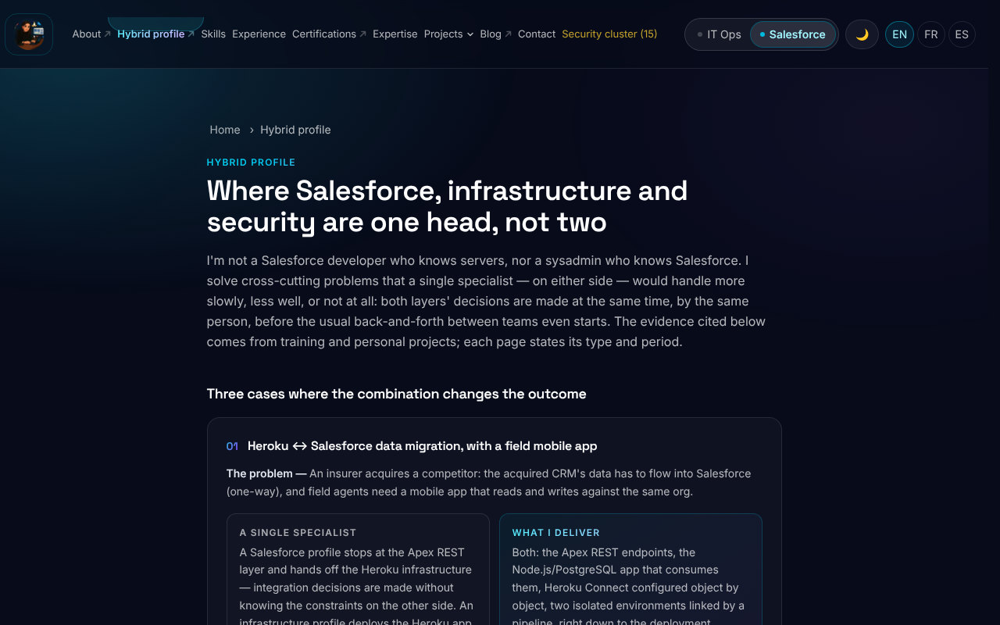
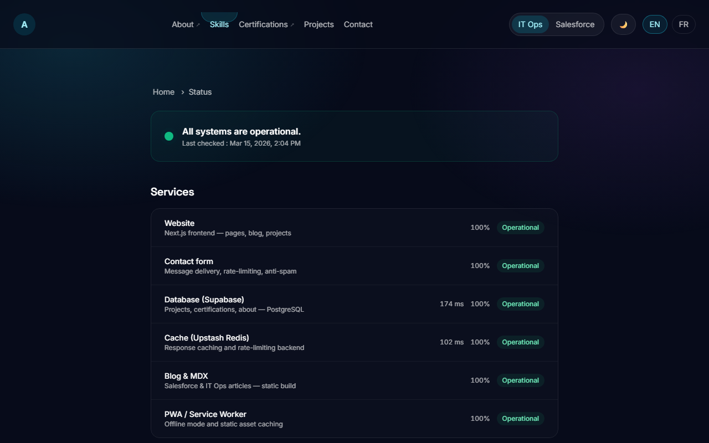

# Aïcha Imène DAHOUMANE — Portfolio

[](https://github.com/Aiyeesha/Aicha-Imene-DAHOUMANE-Portfolio.dev/actions/workflows/ci.yml)
[](https://scorecard.dev/viewer/?uri=github.com/Aiyeesha/Aicha-Imene-DAHOUMANE-Portfolio.dev)
[](https://aicha-imene-dahoumane-portfolio.vercel.app/en)
[](https://aicha-imene-dahoumane-portfolio.vercel.app/en)
[](LICENSE)

Professional portfolio of a **Salesforce Developer & Administrator** targeting Salesforce, systems & network administration, and DevOps roles.
Features a **track toggle** (Salesforce ↔ IT Ops) that dynamically adapts the hero, skills, services, and projects sections.

**Live → [aicha-imene-dahoumane-portfolio.vercel.app/en](https://aicha-imene-dahoumane-portfolio.vercel.app/en)**

---

## Screenshots

| Hero — Salesforce | Hero — IT Ops |
|---|---|
|  |  |

| Blog listing | Blog article |
|---|---|
|  |  |

| About — career timeline | Hybrid profile — Salesforce × IT Ops |
|---|---|
|  |  |

| Status — health checks & sparklines |
|---|
|  |

Screenshots are generated with `node docs/take-screenshots.js` (Playwright, 1280 × 800, dark theme). Set `SCREENSHOT_BASE_URL` to capture a local build and `SCREENSHOT_ONLY` to refresh a subset.

---

## Stack

| Layer | Technology |
|-------|-----------|
| Framework | Next.js 16 (App Router) + React 19 + TypeScript 5 |
| Styling | Tailwind CSS 4 (CSS-first `@theme` in `app/globals.css`) + next-themes (dark mode) |
| Fonts | Space Grotesk + Inter, self-hosted variable WOFF2 (`app/fonts/`, SIL OFL 1.1) via `next/font/local` |
| Animations | Framer Motion (scroll-triggered, parallax, stagger, reduced-motion aware) |
| i18n | next-intl (EN default / FR / ES) |
| Backend | Supabase (PostgreSQL) — projects, contact, testimonials, uptime |
| Cache / Rate-limit | Upstash Redis (stale-while-revalidate + rate-limiting) |
| Blog | MDX (`@next/mdx`) + gray-matter + rehype/remark + article series |
| Forms | API Route → Formhook (e-mail delivery, no storage at rest) + honeypot + rate-limit |
| Booking | Plain link to a Proton Calendar booking page (no third-party script) |
| Analytics | None — no audience measurement or visitor tracking; performance is checked in CI with Lighthouse CI |
| Monitoring | Vercel Cron (daily at 08:00 UTC) → `/api/cron/ping` → Supabase `uptime_pings` |
| Deployment | Vercel (Hobby) |

---

## Architecture

```
Browser
  │
  ├─ Next.js 16 (App Router — SSR + ISR)
  │     ├─ Server Components → Supabase REST API ──► PostgreSQL
  │     │                    → Upstash Redis (cache, rate-limit)
  │     ├─ Client Components → Framer Motion, next-intl, track toggle
  │     └─ API Routes
  │           ├─ /api/contact          → Formhook (e-mail, nothing stored)
  │           ├─ /api/health           → ping Supabase + Redis + Formhook
  │           ├─ /api/cron/ping        → Vercel Cron (daily 08:00 UTC) → uptime_pings
  │           ├─ /api/errors           → client JS error reports (GlobalErrorHandler)
  │           └─ /api/testimonial-submit → testimonial_submissions
  │
  ├─ Supabase (PostgreSQL + RLS)
  │     Tables: projects · project_assets · about_pages · certifications
  │             messages · testimonials · testimonial_submissions
  │             goals_2026 · uptime_pings
  │
  ├─ Upstash Redis
  │     Rate-limit: portfolio:rl:{contact,blog,testimonial,admin,errors,
  │                 revalidate,cache-invalidate,csp-report,csp-alert}
  │                 (identifiers HMAC-pseudonymised with IP_HASH_SALT)
  │     Cache:      portfolio:uptime:* · project:* · projects_with_assets:*
  │
  └─ Vercel
        CDN (static assets, ISR pages)
        Cron jobs (vercel.json)
```

---

## Features

- **Dual-track hero** — Salesforce and IT Ops profiles share the same avatar; text, tags, and accent colors adapt per track
- **Availability modal** — pulsing "open to work" badge in the hero; click opens a modal detailing contract types, work modes, target roles, and location (FR/EN/ES)
- **Dedicated pages** — `/about`, `/hybride` (hybrid Salesforce × IT Ops profile), `/work-with-me`, `/contact`, `/certifications`, `/blog`, `/projects`, `/status`, `/resources`, `/colophon`, `/uses`
- **Career timeline** — visual timeline (2022 → present) on the About page
- **Blog** — 14 MDX articles in each of EN / FR / ES, syntax highlighting, copy button, table of contents, reading time, article series, track-filtered homepage preview
- **Article series** — curated reading paths across related articles
- **Certifications page** — completed certifications, in-progress items with target dates, and the roadmap
- **Testimonial form** — `/testimonial-submit?token=SECRET` — token-gated, stores to Supabase with `approved = false`
- **Contact form** — rate-limited, honeypot, topic selector; delivered by e-mail through Formhook
- **Booking** — "Book a call" links (hero, contact section, `/work-with-me`, mobile menu) open the Proton Calendar booking page in a new tab
- **Status page** — real health checks (Supabase, Redis, Formhook, content integrity), uptime % over 30 days, latency sparklines (7 days); localized service names
- **Admin dashboard** — `/admin` (HTTP Basic Auth) — project/cert/testimonial/message stats and recent contact messages
- **Command palette** — `⌘K` / `Ctrl+K` — navigate sections and pages (including `/hybride`), switch track/theme/language, download CV, open LinkedIn — fully translated
- **Animations** — Framer Motion: scroll parallax, directional reveals, stagger, AnimatedCounter, AnimatePresence on track switch
- **Open Graph** — dynamic OG images per blog article, project page, `/about`, `/certifications` and `/hybride` (`next/og`)
- **Security headers** — CSP, HSTS, X-Frame-Options, Referrer-Policy, Permissions-Policy, COOP, CORP; `X-Powered-By` suppressed
- **RSS feeds** — `/feed.xml` (EN), `/feed-fr.xml` (FR), `/feed-es.xml` (ES)
- **PWA** — Web App Manifest (installable), service worker with offline fallback (`/admin` and the testimonial form are never cached)
- **Localized 404** — unknown URLs under `/fr`, `/en`, `/es` render the 404 in the URL's language (`app/[locale]/[...rest]`)
- **Accessibility** — skip link, keyboard nav, focus rings, ARIA landmarks, WCAG 2.2 AA
- **SEO** — JSON-LD (WebSite + Person, BlogPosting, FAQPage, BreadcrumbList), sitemap of indexable pages only, robots.txt, hreflang EN / FR / ES + x-default
- **No analytics** — no audience measurement, no visitor tracking, no third-party script

---

## Getting started

### Prerequisites

- Node.js 24+
- npm (or pnpm / bun)

### Install & run

```bash
git clone https://github.com/Aiyeesha/Aicha-Imene-DAHOUMANE-Portfolio.dev.git
cd Aicha-Imene-DAHOUMANE-Portfolio.dev
npm install
cp .env.example .env.local   # then fill in the required values
npm run dev
```

Open [http://localhost:3000/en](http://localhost:3000/en)

### Build

```bash
npm run build
npm start
```

---

## Environment variables

Copy `.env.example` to `.env.local` and fill in the values.
All `NEXT_PUBLIC_*` variables are exposed to the browser. Never put secrets in them.

| Variable | Required | Description |
|----------|----------|-------------|
| `NEXT_PUBLIC_SITE_URL` | ✅ | Canonical site URL (no trailing slash) |
| `NEXT_PUBLIC_SUPABASE_URL` | ✅ | Supabase project URL |
| `NEXT_PUBLIC_SUPABASE_ANON_KEY` | ✅ | Supabase anon key (public) |
| `SUPABASE_SERVICE_ROLE_KEY` | ✅ | Supabase service role key (server-only, never expose) |
| `UPSTASH_REDIS_REST_URL` | ✅ | Upstash Redis REST endpoint |
| `UPSTASH_REDIS_REST_TOKEN` | ✅ | Upstash Redis REST token (server-only) |
| `FORMHOOK_ENDPOINT` | Recommended | Formhook form endpoint URL |
| `FORMHOOK_AUTH_TOKEN` | Recommended | Formhook X-Auth-Token — required for server-to-server submissions, Origin allow-listing alone rejects them |
| `NEXT_PUBLIC_CONTACT_EMAIL` | Recommended | Displayed contact email |
| `NEXT_PUBLIC_LINKEDIN_URL` | Recommended | LinkedIn profile URL |
| `NEXT_PUBLIC_BOOKING_URL` | Optional | Proton Calendar booking page link (HTTPS) — overrides the default link in `lib/booking.ts` |
| `NEXT_PUBLIC_CV_PDF_URL` | Optional | CV PDF URL (fallback: `/cv/Aicha-Imene-DAHOUMANE-CV-{locale}-{track}.pdf`) |
| `NEXT_PUBLIC_AVATAR_URL` | Optional | Avatar image URL (fallback: `/avatar.webp`) |
| `NEXT_PUBLIC_SAME_AS` | Optional | Comma-separated social profile URLs (JSON-LD sameAs) |
| `CACHE_INVALIDATE_SECRET` | Optional | Secret for `/api/cache/invalidate` endpoint |
| `CONTACT_RATE_LIMIT_WINDOW_SECONDS` | Optional | Rate-limit window in seconds (default: 600) |
| `CONTACT_RATE_LIMIT_MAX_REQUESTS` | Optional | Max requests per window (default: 5) |
| `TESTIMONIAL_SUBMIT_TOKEN` | Optional | Token for `/[locale]/testimonial-submit?token=...` (generate with `openssl rand -base64 32`) |
| `CRON_SECRET` | Optional | Bearer token Vercel sends to `/api/cron/ping` — set in Vercel Dashboard (generate with `openssl rand -base64 32`) |
| `ADMIN_USERNAME` | Optional | Username for `/admin` HTTP Basic Auth |
| `ADMIN_PASSWORD` | Optional | Password for `/admin` HTTP Basic Auth (generate with `openssl rand -base64 32`) |
| `REVALIDATE_SECRET` | Optional | Shared secret for `/api/revalidate` (header `x-revalidate-secret`, Supabase webhook) |
| `IP_HASH_SALT` | Recommended | HMAC key that pseudonymises IP-based rate-limit identifiers before they reach Redis (generate with `openssl rand -hex 32`) |
| `HEALTHCHECK_URL` | Optional | Dead-man's switch URL pinged after each successful `/api/cron/ping` run |
| `ALERT_WEBHOOK_URL` | Optional | Discord/Slack/ntfy webhook alerted when global status != operational |
| `CSP_ALERT_WEBHOOK_URL` | Optional | Discord/Slack/ntfy webhook alerted on CSP violation reports (rate-limited) |
| `NEXT_PUBLIC_SITE_NAME` / `NEXT_PUBLIC_OG_NAME` / `NEXT_PUBLIC_OG_HEADLINE` | Optional | Site name, person name and headline used in metadata and OG images |
| `NEXT_PUBLIC_BRAND_INITIALS` | Optional | Navbar logo initials (default: `A`) |
| `NEXT_PUBLIC_SITE_LASTMOD` | Optional | Pins sitemap `lastModified` (YYYY-MM-DD); defaults to build date |
| `NEXT_PUBLIC_SHOW_TESTIMONIALS` | Optional | `true` to display the testimonials section (currently disabled) |

---

## Project structure

```
.
├── instrumentation.ts          # Next.js server startup hook — runs lib/env.ts validation
├── app/
│   ├── [locale]/               # Locale-scoped pages (App Router)
│   │   ├── page.tsx            # One-page landing (home)
│   │   ├── [...rest]/          # Catch-all → notFound() — localized 404
│   │   ├── about/              # About page + opengraph-image.tsx
│   │   ├── hybride/            # Hybrid Salesforce × IT Ops profile + opengraph-image.tsx
│   │   ├── work-with-me/       # Recruiter page (contract types, FAQ, booking link)
│   │   ├── contact/            # Contact page
│   │   ├── certifications/     # Certifications & Diplomas + opengraph-image.tsx
│   │   ├── blog/               # Blog index + [slug] post pages + tags/
│   │   ├── projects/           # Projects [slug] detail pages + opengraph-image.tsx
│   │   ├── status/             # Public status page (health checks, uptime, sparklines)
│   │   ├── resources/          # Boîte à outils (20 tools, 4 categories)
│   │   ├── security/           # Security acknowledgments (linked from security.txt)
│   │   ├── colophon/           # Full stack documentation
│   │   ├── uses/               # Tools & setup page
│   │   ├── legal/              # Legal notice
│   │   ├── privacy/            # Privacy policy
│   │   ├── accessibility/      # Accessibility statement
│   │   ├── testimonial-submit/ # Token-gated testimonial form
│   │   ├── error.tsx           # Locale error boundary (500 — useParams locale)
│   │   ├── not-found.tsx       # Locale 404 (useParams — no hydration flash)
│   │   └── layout.tsx          # Locale layout (Navbar, Footer, ScrollToTop)
│   ├── admin/                  # Admin dashboard (HTTP Basic Auth, Supabase service_role)
│   ├── api/                    # API routes
│   │   ├── contact/            # Contact form → Formhook (nothing stored)
│   │   ├── cache/invalidate/   # Manual Redis cache invalidation
│   │   ├── cron/ping/          # Vercel Cron (daily 08:00 UTC) → uptime_pings
│   │   ├── errors/             # Client JS error reports (GlobalErrorHandler → sendBeacon)
│   │   ├── health/             # Ping Supabase + Redis + Formhook
│   │   ├── csp-report/         # CSP violation reports (query strings stripped before logging)
│   │   ├── blog/latest/        # Latest posts API (locale whitelist)
│   │   ├── search/             # Blog full-text search (MiniSearch, query capped at 64 chars)
│   │   ├── revalidate/         # ISR revalidation (Supabase webhook)
│   │   ├── admin/              # Admin-only APIs (testimonial invitations)
│   │   └── testimonial-submit/ # Token-gated testimonial submission
│   ├── error.tsx               # Root error boundary (500)
│   ├── feed.xml/ feed-fr.xml/ feed-es.xml/  # RSS feeds (EN / FR / ES)
│   ├── fonts/                  # Self-hosted variable fonts + OFL licences
│   ├── globals.css             # Tailwind 4 entry point (@theme, @source, dark variant)
│   ├── sw.js/                  # Service worker route (cache version = commit hash)
│   ├── not-found.tsx           # Root 404 fallback (outside locale routes)
│   ├── layout.tsx              # Root HTML layout (JSON-LD, fonts, GlobalErrorHandler)
│   ├── opengraph-image.tsx     # Default OG image (1200×630)
│   ├── twitter-image.tsx       # Twitter card image
│   ├── sitemap.ts              # Dynamic sitemap
│   ├── robots.ts               # robots.txt
│   └── manifest.ts             # PWA manifest
├── components/                 # Reusable React components (Server + Client)
├── content/
│   ├── blog/
│   │   ├── posts/{en,fr,es}/   # 14 MDX articles × 3 locales
│   │   ├── registry.ts         # Article metadata registry
│   │   ├── series.ts           # Article series definitions
│   │   └── toc.ts              # Table of contents utilities
│   ├── about.ts                # Static about content (FR / EN / ES)
│   ├── certifications.ts       # Static certifications data
│   ├── experience.tsx          # Work experience accordion data
│   ├── testimonials.ts         # Testimonials (feature-flagged)
│   └── skills.ts / services.ts
├── lib/
│   ├── data/                   # Supabase data fetchers (cached via Redis)
│   ├── supabase/               # Supabase client helpers (anon + service_role)
│   ├── security/               # timingSafeEqual.ts (HMAC-SHA256), jsonLdSafe.ts, slug.ts
│   ├── env.ts                  # Zod env validation (called from instrumentation.ts)
│   ├── social.ts               # LinkedIn / GitHub URL sanitization (single source)
│   ├── booking.ts              # Proton Calendar booking link (default + env override)
│   └── ratelimit.ts / redis.ts / cache.ts  # ratelimit.ts also pseudonymises keys (HMAC)
├── messages/
│   ├── en.json                 # English translations (~410 keys)
│   ├── fr.json                 # French translations (same keys)
│   └── es.json                 # Spanish translations (same keys)
├── supabase/
│   ├── migrations/             # DDL + RLS (numérotés, appliqués par db:migrate)
│   ├── seeds/                  # Données initiales des projets
│   └── scripts/                # Correctifs one-off déjà appliqués (référence)
├── scripts/                    # Utility scripts (db:migrate, CV generation)
└── public/
    ├── .well-known/
    │   └── security.txt        # RFC 9116 security contact
    ├── companies/              # Trusted-by company logos (webp)
    ├── projects/               # Project screenshots and source files
    └── cv/                     # CV PDFs (per locale/track)
```

---

## Deployment (Vercel)

1. Import the repository in [Vercel](https://vercel.com) (the app lives at the repository root)
2. Configure all required environment variables (Production and Preview)
3. Region: `fra1` (see `vercel.json`); daily cron at 08:00 UTC
4. Deploy — Vercel handles build, CDN, and HTTPS automatically. `NEXT_PUBLIC_*` values are inlined at build time: redeploy after changing one.

---

## Scripts

```bash
npm run dev          # Development server
npm run build        # Production build
npm run start        # Start production server
npm run lint         # ESLint
npm run typecheck    # TypeScript check (tsc --noEmit)
npm test             # Jest unit tests
npm run test:e2e     # Playwright end-to-end tests (incl. axe accessibility checks)
```

---

## Security

| Layer | Measure |
|-------|---------|
| HTTP headers | Per-request nonce CSP with `'strict-dynamic'`, no third-party script/style/frame origins, `frame-src 'none'`; Trusted Types in report-only; HSTS (2 yr + preload), X-Frame-Options, Referrer-Policy, Permissions-Policy, COOP, CORP — `X-Powered-By` suppressed |
| Database | Supabase RLS on all tables — `project_assets` restricted to published projects only; `is_admin()` REVOKE'd from PUBLIC; trigger functions have `search_path = ''` |
| Rate-limiting | Upstash Redis sliding window on `/api/contact`, `/api/blog/latest`, `/api/testimonial-submit`, `/api/cache/invalidate`, `/api/revalidate`, `/api/health`, `/api/errors`, `/api/csp-report` and `/admin`; identifiers HMAC-pseudonymised (no IP in clear in Redis). Behaviour during a Redis outage is documented in SECURITY.md |
| Admin panel | HTTP Basic Auth + proxy rate-limit (5 req / 15 min / IP), never cached by the service worker |
| Contact form | Honeypot, origin check, server-side input validation, e-mail delivery via Formhook with no storage at rest |
| Privacy | No analytics or tracking; no third-party script; CSP reports logged without query strings |
| Env validation | `instrumentation.ts` → `lib/env.ts` validates all env vars via Zod at server startup — catches missing secrets, invalid URLs, tokens with whitespace |
| Credential comparison | `lib/security/timingSafeEqual.ts` — HMAC-SHA256 timing-safe comparison (Web Crypto API, Edge Runtime compatible) |
| Debug routes | `/api/redis-test` returns 404 in production |
| Crawlers | `robots.txt` disallows `/cv/` and `/admin/` |

See [`SECURITY.md`](SECURITY.md) for the full security policy and vulnerability disclosure process.
Security contact: [`/.well-known/security.txt`](public/.well-known/security.txt)

---

## License

MIT — see [LICENSE](LICENSE).
Content (texts, CV, photos) © Aïcha Imène DAHOUMANE — all rights reserved.
